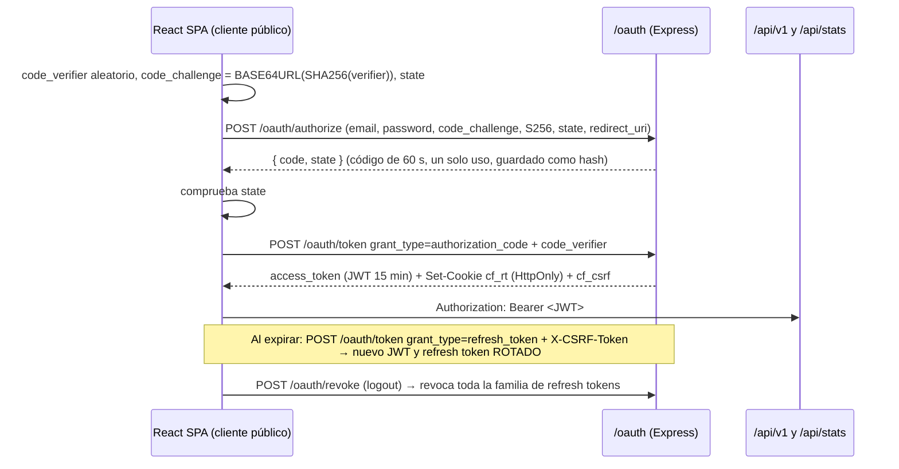

# API, OAuth 2.1 y JWT

Documentación interactiva: **`/api/docs/`** (Express) y **`/api/stats/docs/`** (Django).
Contrato: [`backend/src/docs/openapi.yaml`](../backend/src/docs/openapi.yaml) (OpenAPI 3.0.3).

## Flujo de autenticación (OAuth 2.1 Authorization Code + PKCE)



### Qué exige OAuth 2.1 y cómo se cumple

| Requisito OAuth 2.1 | Implementación |
|---|---|
| PKCE obligatorio en authorization code | `code_challenge` requerido, solo `S256` (`plain` → 400) |
| Sin *implicit grant* ni *password grant* | `response_type=token` y `grant_type=password` → error |
| `redirect_uri` con coincidencia exacta | lista blanca por cliente; nunca se redirige a una URI no registrada |
| Códigos de un solo uso y vida corta | 60 s, marcado atómico `used_at` |
| Refresh tokens de clientes públicos rotados | rotación en cada uso + **detección de reutilización** (revoca la familia) |
| Tokens nunca en la query string | solo cabecera `Authorization: Bearer` |
| Metadatos del servidor | `/.well-known/oauth-authorization-server` (RFC 8414) |

> El formulario de login vive en la SPA (cliente *first-party*), que llama a `/oauth/authorize` con `Accept: application/json`.
> Sin esa cabecera el endpoint responde con el **302** clásico a `redirect_uri?code=…&state=…` (la ruta `/callback` de la SPA lo procesa).

### Access token (JWT)

```json
{ "alg": "HS256", "typ": "at+jwt" }
{ "sub": "12", "iss": "campusfind-auth", "aud": "campusfind-api", "exp": 1763000000, "iat": 1762999100,
  "jti": "uuid", "client_id": "campusfind-web", "scope": "profile objects:read objects:write messages:read messages:write",
  "name": "Alice", "email": "alice@uni.edu" }
```

* Firma HS256 con `JWT_SECRET` (≥ 32 caracteres, leído desde secreto). Express y Django verifican **algoritmo, firma, `iss`, `aud` y `exp`**; `alg=none` se rechaza.
* *Scopes* por endpoint (`requireAuth('objects:write')`), 403 `insufficient_scope` si faltan.
* Evolución recomendada: RS256/ES256 + JWKS para que los resource servers no compartan el secreto.

## Endpoints

| Método | Ruta | Auth | Descripción |
|---|---|---|---|
| POST | `/api/v1/users` | — | Registro |
| GET | `/api/v1/users/me` | `profile` | Perfil |
| GET | `/api/v1/objects` | — | Búsqueda: `keyword, category, status, location, date, limit≤50, offset` |
| GET | `/api/v1/objects/{id}` | — | Detalle |
| POST | `/api/v1/objects` | `objects:write` | Crear (multipart, imagen opcional ≤ 5 MB) |
| PATCH | `/api/v1/objects/{id}` | `objects:write` + dueño | Editar |
| DELETE | `/api/v1/objects/{id}` | `objects:write` + dueño | Borrar |
| GET | `/api/v1/messages` | `messages:read` | Bandeja de entrada |
| POST | `/api/v1/messages` | `messages:write` | Contactar al dueño de un objeto |
| POST | `/api/v1/messages/read` | `messages:write` | Marcar todo como leído |
| PATCH | `/api/v1/messages/{id}` | `messages:write` + receptor | Marcar leído/no leído |
| GET | `/api/stats/summary/` · `/by-category/` · `/top-locations/` · `/timeline/?days=` | — | Estadísticas (Django) |
| GET | `/api/stats/me/` | JWT | Estadísticas personales (Django valida el JWT) |
| GET | `/health/live` · `/health/ready` | — | Probes de Kubernetes (no expuestos por el gateway) |

### Equivalencia con la v1 (PHP)

| v1 | v2 |
|---|---|
| `register.php` | `POST /api/v1/users` |
| `login.php` / `check_session.php` / `logout.php` | `/oauth/authorize` + `/oauth/token` / `GET /users/me` / `/oauth/revoke` |
| `get_objects.php` | `GET /api/v1/objects` |
| `save_object.php` | `POST /api/v1/objects` |
| `send_message.php` / `get_messages.php` | `POST` / `GET /api/v1/messages` |

## Probar con Swagger y Postman

* **Swagger UI**: obtén un token (con Postman o el navegador) y pulsa *Authorize* → `bearerAuth`.
* **Postman**: importa `postman/CampusFind.postman_collection.json` y el entorno local. La colección registra dos usuarios,
  genera el par PKCE en un *pre-request script* (CryptoJS), recorre todo el flujo OAuth y las pruebas OWASP. Ejecútala completa con el *Collection Runner* o con Newman.
