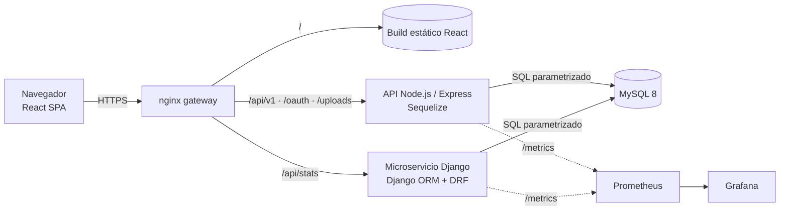
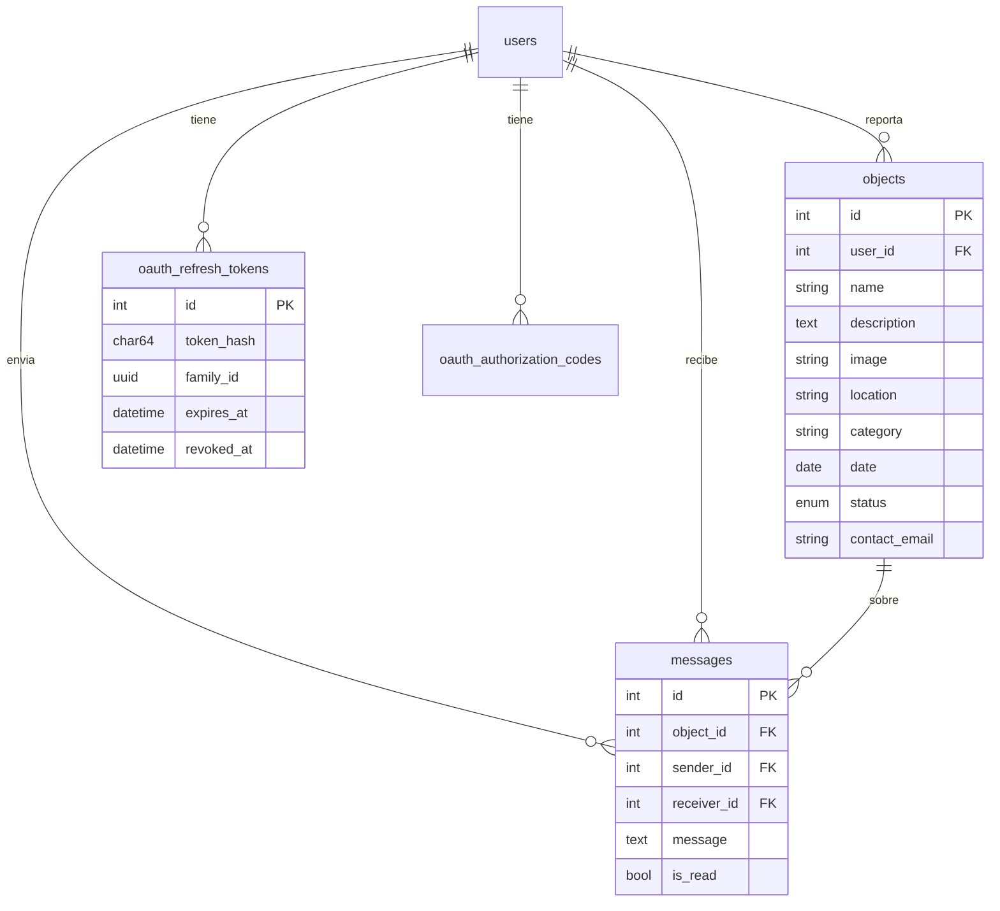

# Arquitectura

## Cliente-servidor

CampusFind sigue una arquitectura **cliente-servidor en capas** con un gateway único:

| Capa | Responsabilidad |
|---|---|
| **Cliente (React)** | Presentación y estado de UI. No guarda tokens en `localStorage`: el access token vive en memoria y el refresh token es una cookie HttpOnly. |
| **Gateway (nginx)** | Un solo origen para el navegador → cookies `SameSite=Strict`, sin CORS en producción, cabeceras de seguridad (CSP). |
| **API (Express)** | Lógica de negocio, validación (zod), autorización por objeto, servidor de autorización OAuth 2.1, subida de imágenes. Dueña del esquema (migraciones Sequelize). |
| **Stats (Django)** | Consultas agregadas de solo lectura. Es un *resource server*: valida los JWT emitidos por la API. |
| **Datos (MySQL)** | Persistencia relacional con claves foráneas e índices. |

### ¿Por qué dos backends?
Se pidió usar **Express y Django**. En lugar de duplicar la misma API, cada uno tiene un rol
natural en una arquitectura de microservicios:

* **Express** concentra las escrituras y la seguridad (OAuth, uploads), donde el ecosistema Node encaja bien con I/O concurrente.
* **Django** aporta un ORM muy expresivo para agregaciones (`Count`, `filter=Q(...)`, `TruncDate`) y genera su propio OpenAPI con drf-spectacular.
* Comparten la base de datos pero **un solo dueño del esquema** (Sequelize); los modelos Django son `managed = False`.

## API REST moderna

* Recursos en plural y versionados: `/api/v1/objects`, `/api/v1/messages`, `/api/v1/users`.
* Verbos y códigos correctos: `201 + Location` al crear, `204` al borrar, `409` en conflicto, `413` en payload grande, `429` con cabeceras `RateLimit` (draft-7).
* Errores **RFC 9457** (`application/problem+json`) con lista de errores por campo.
* Paginación `limit/offset` acotada y sobre `{ data, total, limit, offset }`.
* Contrato **OpenAPI 3.0.3** como fuente única: Swagger UI, colección Postman y generador de tests con IA lo consumen.
* Sin estado en el servidor (stateless): la identidad viaja en el JWT → escala horizontal (HPA).

## Modelo de datos (ORM)

* **Sequelize**: modelos en `backend/src/models`, asociaciones (`hasMany`/`belongsTo`), *scopes* (`defaultScope` excluye `password`), migraciones idempotentes que **reutilizan la BD de XAMPP** si ya existe.
* **Django ORM**: `stats-service/stats/models.py` mapea las mismas tablas sin la columna `password`.

## Frameworks frontend

Se implementó **React**. Angular y Vue.js consumirían exactamente la misma API; las piezas a portar son:

| Pieza | React (implementado) | Angular | Vue 3 |
|---|---|---|---|
| Rutas | `react-router-dom` | `@angular/router` + `canActivate` | `vue-router` + `beforeEach` |
| Estado de sesión | Context `AuthProvider` | Servicio `@Injectable` singleton | `pinia` store |
| Llamadas HTTP | `api/client.js` (fetch) | `HttpClient` + `HttpInterceptor` (Bearer + refresh en 401) | `fetch`/axios + interceptor |
| Escapado XSS | JSX escapa por defecto | Interpolación `{{ }}` escapa; evitar `bypassSecurityTrust*` | `{{ }}` escapa; evitar `v-html` |
| PKCE | `auth/pkce.js` (Web Crypto) | Igual (o `angular-oauth2-oidc`) | Igual (o `oidc-client-ts`) |

Para cambiar de framework basta con reemplazar `frontend/` manteniendo `nginx.conf` y el `Dockerfile` (build estático + nginx).
