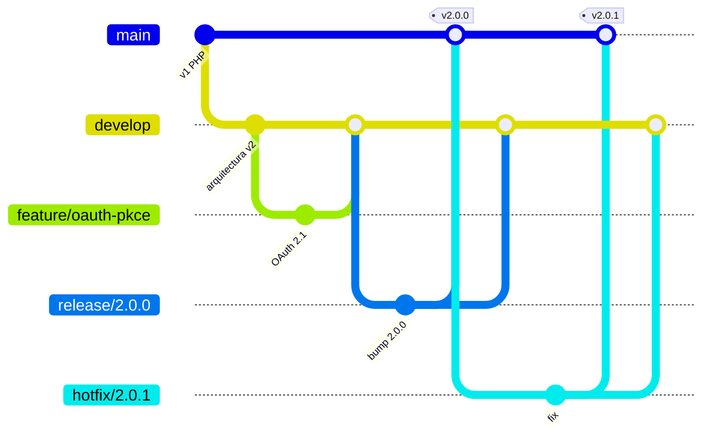

# Git, GitHub y GitFlow

## Ramas



| Rama | Sale de | Se fusiona en | Uso |
|---|---|---|---|
| `main` | — | — | Producción. Cada *push* dispara **CD**. Solo recibe `release/*` y `hotfix/*`. |
| `develop` | `main` | — | Integración continua de la siguiente versión. |
| `feature/<issue>-<desc>` | `develop` | `develop` | Nuevas funcionalidades. |
| `bugfix/<desc>` | `develop` | `develop` | Correcciones no urgentes. |
| `release/X.Y.Z` | `develop` | `main` **y** `develop` | Estabilización; solo fixes y versión. Se etiqueta `vX.Y.Z`. |
| `hotfix/X.Y.Z` | `main` | `main` **y** `develop` | Fix urgente en producción. |

El workflow `gitflow-guard.yml` rechaza PRs que no respeten esta tabla o el formato de nombre.

## Flujo de trabajo

```bash
# Nueva funcionalidad
git switch develop && git pull
git switch -c feature/42-filtro-por-fecha
git commit -m "feat(objects): filtrar por rango de fechas"
git push -u origin feature/42-filtro-por-fecha     # abrir PR hacia develop

# Release
git switch -c release/2.1.0 develop
# ajustar versiones en package.json, CHANGELOG...
git switch main && git merge --no-ff release/2.1.0 && git tag -a v2.1.0 -m "v2.1.0"
git switch develop && git merge --no-ff release/2.1.0
git push origin main develop --tags

# Hotfix
git switch -c hotfix/2.1.1 main
# ...fix + PR a main, luego merge a develop
```

Con la extensión **git-flow** (`git flow init -d`) los comandos equivalentes son `git flow feature start …`, `git flow release start …`, etc.

## Convenciones
* **Conventional Commits**: `feat:`, `fix:`, `docs:`, `test:`, `refactor:`, `ci:`, `chore:`, `build:`.
* **SemVer** para las etiquetas `vMAJOR.MINOR.PATCH`.
* PRs con la plantilla `.github/pull_request_template.md` y revisión obligatoria (`CODEOWNERS`).

## Configuración recomendada en GitHub
1. *Settings → Branches → Branch protection rules* para `main` y `develop`:
   requerir PR, 1 aprobación, *status checks* (`API`, `Stats service`, `Web`, `IaC lint`, `GitFlow guard`), historial lineal en `develop`, prohibir *force push*.
2. *Settings → Environments → production*: revisores requeridos (aprobación manual antes de desplegar).
3. *Code security*: Dependabot alerts, secret scanning y push protection.
4. `.github/CODEOWNERS` ya apunta a tu usuario; añade más revisores si el equipo crece.

## Publicar el repositorio

El remoto `origin` ya apunta a `github.com/juandarivera2015-crypto/Campusfind`. Para publicar la rama de integración
y abrir la primera release:

```bash
git push -u origin develop
git switch -c release/2.0.0 develop && git push -u origin release/2.0.0   # PR release/2.0.0 -> main
# tras el merge en main:
git switch main && git pull && git tag -a v2.0.0 -m "CampusFind 2.0.0" && git push origin v2.0.0
git switch develop && git merge --no-ff main && git push
```
